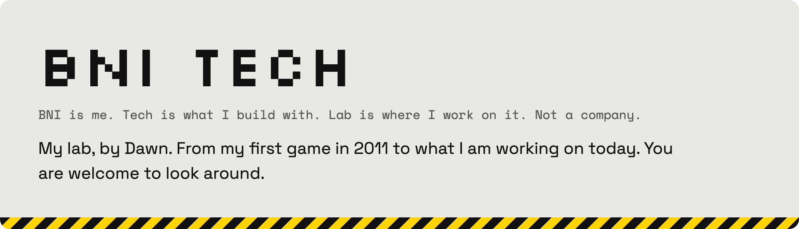
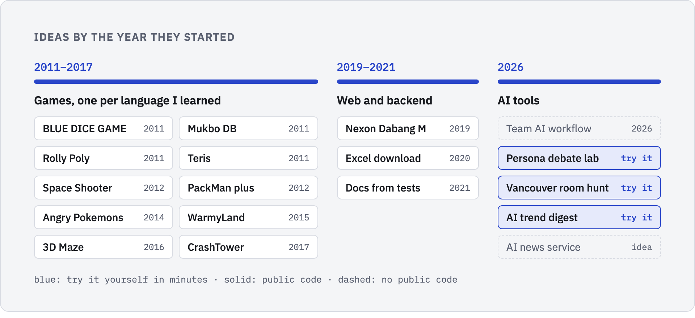

<picture>
  <source media="(prefers-color-scheme: dark)" srcset="assets/banner-dark.png">
  
  </picture>

**[bnitech-lab.github.io →](https://bnitech-lab.github.io)** · by [Dawn](https://github.com/bnivibe)

### Try one

<table>
  <tr>
    <td width="33%" valign="top">
      <b><a href="https://github.com/bnivibe/persona-debate-lab">Persona debate lab</a></b> 
      For anyone who uses Claude Code to think a decision through from several sides. 
      <b>about 10 min</b> · Claude Code skill
    </td>
    <td width="33%" valign="top">
      <b><a href="https://github.com/bnivibe/vancouver-room-hunt">Vancouver room hunt</a></b> 
      For newcomers looking for a room share in Vancouver or elsewhere in BC. 
      <b>about 15 min</b> · Claude Code skill
    </td>
    <td width="33%" valign="top">
      <b><a href="https://github.com/bnivibe/ai-trend-digest">AI trend digest</a></b> 
      For developers who want five AI topics a day instead of five feeds. 
      <b>about 5 min</b> · Python
    </td>
  </tr>
</table>

<picture>
  <source media="(prefers-color-scheme: dark)" srcset="assets/timeline-dark.png">
  
</picture>

### The games, 2011–2017

| Year | Game | Built with | Stage |
|---|---|---|---|
| 2011 | [BLUE DICE GAME](https://github.com/bnitech-lab/blue-dice-game-2011) | Visual Basic 6 | Finished |
| 2011 | [Mukbo DB](https://github.com/bnitech-lab/mukbo-db-2011) | C++, Windows console | Stopped mid-build |
| 2011 | [Rolly Poly](https://github.com/bnitech-lab/rolly-poly-2011) | VB.NET | Stopped mid-build |
| 2012 | [Space Shooter](https://github.com/bnitech-lab/space-shooter-2012) | C++, Win32 GDI | Stopped mid-build |
| 2012 | [PackMan plus](https://github.com/bnitech-lab/packman-plus-2012) | Java, Swing | Finished |
| 2014 | [Angry Pokemons](https://github.com/bnitech-lab/angry-pokemons-2014) | Java, Android | Finished |
| 2016 | [3D Maze](https://github.com/bnitech-lab/maze-3d-2016) | C++, OpenGL | Finished |
| 2017 | [CrashTower](https://github.com/bnitech-lab/crash-tower-2017) | Java, Android | Stopped mid-build |

BNI Tech is the name I put on my first games in 2011. It is not a company.
